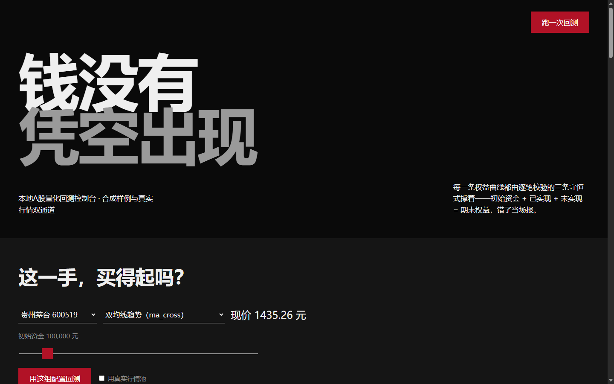

<p align="center">

# QuantForge

**钱没有凭空出现。** A local A-share multi-strategy backtesting engine where every trade
is verified by three conservation equations — built with **zero third-party dependencies**,
129 tests, and a one-command quality gate.

`MIT` · `Python 3.10+` · `pip install: nothing` · `tests: 129`

</p>



---

## Why this exists

Most backtest engines lie quietly: a missing fee here, a same-bar fill there, and the equity
curve drifts up by a few percent per year — indistinguishable from "alpha". QuantForge treats
this as an engineering problem, not a modeling one:

- **Three conservation equations checked per trade** (cash / cash-layer / position):
  `initial + realized + unrealized == equity`, every fill, not every day.
- **Nine-step per-bar sequence** where matching happens *before* signal computation —
  the structural anti-pattern against look-ahead bias. Same-bar-close fills are impossible
  by construction (a banned code path, enforced by static scan).
- **Triple look-ahead detection**: static positive-offset scan, doomsday-trap truncation
  (signal-level), and shift-compare — wired into CI and the `doctor` command.
- **A 52-stage engineering blueprint** (constitution, ADRs, conflict register C-001~042,
  DoD gates) in `docs/` — the design reasoning is part of the artifact.

## Quickstart

```bash
git clone https://github.com/<you>/quantforge && cd quantforge
python qf.py demo          # offline five-things: sample data -> self-check -> backtest -> report -> view
python qf.py gate          # the one-command quality gate: tests + doctor + conservation + perf + artifacts
```

No install. No dependencies. Works offline. The report is a single self-contained HTML file
with inline SVG charts — open `out/report_*.html`.

Want the GUI? `python qf.py console` (local web console, stdlib http.server) or double-click
`启动QuantForge界面.bat` on Windows.

## What's inside

| Layer | What you get |
|---|---|
| Engine | T+1, limit-up/down three scenarios (one-word board: no fill, no forced fill), lot constraints, fund-shortage recalculation, suspension valuation freeze, full A-share fee model (commission 0.25‰ min ¥5, stamp 0.5‰ sell, transfer 0.01‰ SH, slippage 1‰/side) |
| Indicators | 9 indicators with exact conventions (Wilder RSI/ATR/ADX, population σ, EMA seeding) + 45 textbook test cases |
| Strategies | 5 template strategies as regression baseline; user strategies pass a **3-step sandbox** (import whitelist → subprocess with runtime audit hooks → small-sample conservation) |
| Metrics | 12 performance metrics, √250 annualization, peak-denominator drawdown, null-value rules, short-period "reference" flag |
| Analysis | Parameter sweep (random primary / grid ≤2 params, checkpoint resume with checksum double-confirmation, 4 overfitting flags), review agent (5 rule-based verdicts + 4 fixed questions), alerts (merge/escalate/confirm/recover/context) |
| Scale | Three interchangeable backends — serial / parallel (cores−4) / remote (HTTP claim/return with token) — **bitwise-identical results**, verified in tests |
| Data | Synthetic sample generator (self-made, distributable); optional real quotes via akshare (Eastmoney→Sina fallback). **Real data is never shipped** — see D-010 |

## Quality evidence

```text
python qf.py gate
  ✅ unittest 全绿（129）
  ✅ 静态扫描+末日陷阱零命中
  ✅ 三守恒+费用恒等零失败
  ✅ 性能预算（全池≤15s）
  ✅ HTML 单文件报告（零依赖）
门禁判定：全绿 PASS（5/5）
```

CI runs the same suite on Python 3.10/3.13 × Ubuntu/Windows.

## Compliance — the three immutable lines

This project **does not connect to live trading, does not promise returns, and hides no
configuration**. It is a research and education tool: historical backtests do not represent
future performance, and nothing here is investment advice. The sample market data is
program-generated; real market data fetched via the optional layer stays under its original
provider's terms and must never be redistributed.

## Repository map

```text
src/qf/          engine, indicators, strategies, sandbox, sweep, review, alerts,
                 parallel/remote backends, web console (all stdlib)
tests/           129 tests: textbook cases, extreme scenarios (6), conservation,
                 double/triple-backend bitwise identity, sandbox escapes
docs/            the 52-stage blueprint, ADRs D-001~012, conflict register, STATUS board
examples/        sandbox-passing example strategies
qf.py            CLI entry (demo / backtest / sweep / doctor / gate / verify-strategy / console)
```

## Roadmap

V10 cross-market, V11 strategy sharing, V12 automated research — each gated by explicit
trigger conditions (see `docs/S51`), deliberately not started until the trigger fires.

## License

MIT — see `LICENSE`.
