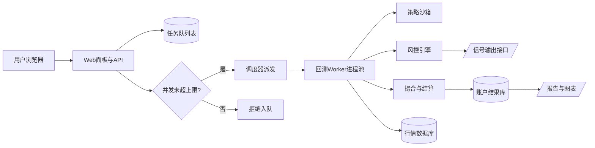

# ADR-001｜顶层架构选型

- 状态：**已作废（Superseded by D-001）**｜日期：2026-11-13（v1.0 编制；2026-11-13 作废）
- 作废原因：用户移交《工程正文》为权威基线（需求基线 Q-REQ-BL-001），其 D-001 决策为单体分层。见冲突单 C-002（docs/S00/07_对齐工程正文_冲突登记与参数修正.md）。本文件保留作历史追溯，不作实现依据。

## 1. 背景与硬约束
- 部署形态：单机私有化（买家为散户/爱好者，多为 Windows + 零基础）；Docker 与原生 Python 双路线。
- 资源硬约束：进程组内存上限 6.0GB（见《01_资源容量与端口预算》§4）；买家最低 8GB 内存机器。
- 铁律10硬约束：策略沙箱隔离——单策略崩溃不得污染其他策略与账户状态 → **单进程内跑策略不可接受**。
- 铁律2硬约束：本决策为核心方案（回测引擎架构），强制3备选。
- 网络环境：国内直连，前端零CDN（X-05）；数据源 AkShare 东财通道已在本机 deepseek-quant 跑通（实现参考，不复用代码）。
- 商业化约束：买家部署失败率必须趋近0 → 部署复杂度权重最高之一。

## 2. 备选方案（9维度逐项，铁律2）

### 方案A｜纯单体单进程
技术结构：FastAPI 一体化进程，回测在请求线程/线程池内执行，SQLite 单库，队列内存化。
资源占用：常驻≈300MB，最省。部署复杂度：一条命令，最低。数据准确度：与C无差（撮合逻辑相同）。稳定性：**差**——策略异常可拖垮Web服务；大遍历阻塞API；违反铁律10沙箱硬约束（线程级隔离不算沙箱）。开发工作量：最小（约15人日估算）。运维成本：最低。商业化适配：好部署但稳定性差引发售后。横向扩展能力：无（GIL锁死多核遍历）。

### 方案B｜微服务容器全家桶
技术结构：FastAPI网关 + Celery Worker + Redis队列 + PostgreSQL + 独立前端容器，5容器编排。
资源占用：常驻≥2.5~3GB（Redis+PG+Celery+网关），逼近/超出低配机器预算。部署复杂度：高——5容器、依赖健康检查、卷权限，买家零基础部署失败率高。数据准确度：与C无差。稳定性：好（进程隔离彻底）。开发工作量：大（约30人日估算，含编排调试）。运维成本：高（日志分散在5容器，买家排障困难）。商业化适配：差——"docker compose up失败"将是最大售后来源。横向扩展能力：最好（V8分布式平滑升级）。

### 方案C｜单体核心 + 回测Worker进程池（选定）
技术结构：FastAPI 主进程（Web+API+调度器+账户结算）；回测任务由**multiprocessing Worker进程池**执行（默认2并发，分钟线1）；任务队列为SQLite任务表（重启不丢，F-1001）；策略在Worker内运行且受import白名单+资源限额约束（F-305沙箱）；Worker崩溃由主进程≤10秒自动重启（RL-04）；数据库为文件型 SQLite（日线+配置+任务+结果）+ DuckDB（分钟线列存，ADR-003 终裁可换）。
资源占用：常驻0.8GB+任务峰值1.5~2.5GB，≤6GB ✅。部署复杂度：2容器（app+备份侧车）或纯原生单命令，买家可承受。数据准确度：与A/B同源同逻辑。稳定性：好——Worker崩溃不伤主进程，队列落盘重启恢复。开发工作量：中（约20人日估算）。运维成本：低（单日志流+面板内置监控）。商业化适配：好（部署简单+崩溃隔离=售后少）。横向扩展能力：中——V8 分布式时Worker协议可平移到多机（当前单机先不做）。

## 3. 打分表（0~10分，权重合计100，铁律2维度全覆盖）

| 维度 | 权重 | 方案A | 方案B | 方案C |
|---|---|---|---|---|
| 技术结构合理性 | 10 | 6 | 8 | 9 |
| 资源占用 | 15 | 9 | 3 | 8 |
| 部署复杂度 | 20 | 10 | 3 | 8 |
| 数据准确度 | 5 | 9 | 8 | 9 |
| 稳定性 | 15 | 5 | 8 | 9 |
| 开发工作量 | 10 | 9 | 4 | 7 |
| 运维成本 | 5 | 9 | 3 | 7 |
| 商业化适配 | 10 | 8 | 3 | 8 |
| 横向扩展能力 | 10 | 3 | 9 | 6 |
| **加权总分** | 100 | **76.0** | **52.0** | **79.5** |

计算示例（方案C）：9×10+8×15+8×20+9×5+9×15+7×10+7×5+8×10+6×10 = 90+120+160+45+135+70+35+80+60 = 795 → 79.5。

## 4. 选型结论
- **选定方案C**：加权79.5分最高，且同时满足铁律10沙箱、6GB内存、买家部署三大硬约束。
- 淘汰A：稳定性维度失分根源=违反铁律10（策略崩溃污染主进程，线程隔离不构成沙箱），属硬约束不达标。
- 淘汰B：资源占用（常驻≥2.5GB+编排复杂度）与商业化适配超出买家可承受边界，52.0分最低。

## 5. 后果与强制约束（对后续阶段）
1. S01 数据库选型（ADR-003）必须在 SQLite/DuckDB 边界内论证（方案C为文件型库；PostgreSQL 若入选必须论证买家部署成本——默认不选）。
2. 任务队列不用Redis：F-1001 状态持久化落 SQLite 任务表，Worker 轮询间隔1秒（P-13 ≤3秒由此保障）。
3. 策略沙箱 = Worker进程级 + import白名单（SEC-07）双保险，S05/S15 落地。
4. 回测撮合器与模拟盘共用同一代码路径（R-008 保护），仅时钟与推送分支隔离（F-704）。
5. PDF 双引擎：Windows 原生路线用系统 Edge headless print-to-pdf（本机已验证管线），Docker 路线用 WeasyPrint + 内嵌思源黑体（ENV-05）；S11 终裁细节。
6. 端口 8500 单端口承载（UI+/api），绑定 127.0.0.1（SEC-01）。

## 6. 架构图（铁律3规范：LR、全实线、节点≤12字、形状合规）+ 分支解释表

| 编号 | 分支ID | 分支含义 | 正常逻辑 | 异常分支 | 边界条件 | 失效后果 | 整改措施 |
|---|---|---|---|---|---|---|---|
| 1 | E1 | 提交任务 | 写任务队列表（SQLite任务库） | 队列≥200个→拒绝入队（语义429） | 队列上限B-21=200 | 任务丢失 | 拒绝时返回明确错误码+告警"警告" |
| 2 | E2 | 并发闸门判断 | 运行中<上限（默认2，分钟线1）→派发 | 达上限→任务保持待排队 | 上限B-13=2/硬8；内存水位6GB | 队列堆积 | 水位联动拒绝新任务（§4资源上限表） |
| 3 | E3 | 拒绝入队 | 返回429语义+告警 | — | — | 用户误以为提交成功 | 面板即时提示+任务不落库 |
| 4 | E4 | Worker执行 | 沙箱内跑策略+引擎撮合 | Worker崩溃→主进程≤10秒重启Worker，任务回队列按断点续跑 | RL-04≤10秒 | 任务悬挂 | 心跳检测30秒超时判定 |
| 5 | E5 | 风控拦截 | 信号→风控→委托 | 拦截→记录F-505日志，不生成委托 | 每bar执行（铁律10要求） | 超风险持仓 | 拦截原因落日志可查 |
| 6 | E6 | 信号输出 | 仅模拟盘模式经鉴权Webhook出网 | 回测模式该代码路径不存在（F-704） | API Key 256位hex | 回测误推送（X-02） | 通道隔离+双跑对账R-008 |
| 7 | E7 | 结算落库 | 每bar结算写账户结果库 | 对账差>0.01元→任务终止（R-005） | RL-07容差0.01元 | 资金曲线失真 | 整数分记账+快照 |
| 8 | E8 | 读行情库 | 只读连接+按标的/时间分片查询 | 库锁冲突→重试3次退避1秒 | 分片查询（S01 DoD） | 查询超时 | 列存/索引优化在S01落地 |
| 9 | E9 | 报告生成 | 异步任务渲染，不阻塞引擎 | 渲染超时60秒→失败告警"通知" | P-10≤30秒 | 面板无图 | 异步+缓存+30天清理 |

## 7. 后续 ADR 注册表（编号预占，禁止复用）

| 编号 | 主题 | 决策阶段 |
|---|---|---|
| ADR-002 | 数据源终选（AkShare/Baostock/Tushare/离线包） | S02 |
| ADR-003 | 数据库选型（SQLite/PostgreSQL/DuckDB，含存储引擎分层） | S01 |
| ADR-004 | 撮合与滑点模型终选 | S03 |
| ADR-005 | 参数遍历调度终选（网格/随机/贝叶斯） | S06 |
| ADR-006 | 可视化框架终选（Matplotlib/Plotly/ECharts） | S10 |
| ADR-007 | 部署形态终选（Docker/原生/混合） | S18 |
| ADR-008 | V2 组合调仓引擎（组合模型/再平衡触发） | S21 |
