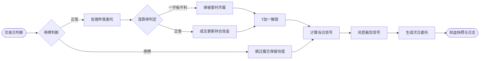
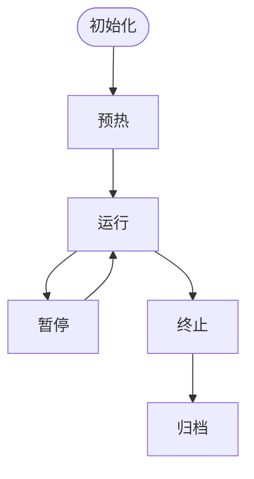

# S03-02｜撮合时序图与分支解释表

- 文档编号：S03-02｜版本：v1.0｜日期：2026-11-13
- 规范依据：铁律八（图表规范）——流程图默认从左到右，复杂状态机自上而下；只用实线，禁止虚线、阴影与填色；起止用圆角矩形，流程用矩形，判断用菱形，输入输出用平行四边形；节点文字≤12字；图后必须附分支解释表。

## 图1｜单根K线九步时序（LR）

### 分支解释表（图1）
| 编号 | 分支ID | 分支含义 | 正常逻辑 | 异常分支 | 边界条件 | 失效后果 | 整改措施 |
|---|---|---|---|---|---|---|---|
| 1 | E1 | 交易日判断 | 交易日→进入停牌判断 | 非交易日→直接跳到下一根K线 | 交易日历缺失 | 非交易日产生成交 | 日历校验交S01交易日历，缺失即报错 |
| 2 | E2 | 停牌判断为真 | 跳过撮合，保留持仓估值，不生成信号 | 停牌标记缺失 | 停牌区间标记来自S02缺口补采 | 停牌期凭空成交 | 标记缺失按S02校验层处理，不进引擎 |
| 3 | E3 | 停牌判断为假 | 处理昨夜委托，按开盘价撮合 | 委托队列为空→直接进入涨跌停判定 | 委托作废后队列清空 | 空队列空转（无失效，仅性能） | 队列空时短路跳过步骤3 |
| 4 | E4 | 涨跌停判定为一字板不利 | 买单遇开盘涨停/卖单遇开盘跌停→不成交，委托保留至收盘后作废 | 开盘价高于涨停价（或低于跌停价） | 一字板判定依据开盘价与全天封板 | 一字板误成交，收益虚高约一成 | 数据异常交S02校验层，不在引擎消化 |
| 5 | E5 | 涨跌停判定为正常 | 按委托价与价格区间撮合：买单价≥最低价、卖单价≤最高价 | 委托价不在区间内→不成交 | 跳空情形按开盘价成交（C-026） | 委托价优于开盘价时免费获得价差 | 统一按开盘价成交，委托价仅留痕 |
| 6 | E6 | 保留委托→T+1解锁 | 一字板未成交委托随当日收盘作废 | 作废延迟 | 当日委托当日有效 | 隔夜委托污染次日撮合 | 收盘后强制作废并记录 |
| 7 | E7 | 成交更新→T+1解锁 | 成交结果更新持仓与现金后执行解锁 | 守恒式校验失败 | 逐笔校验三条守恒式 | 资金凭空出现/权益上漂 | 校验失败即中断回测并留痕 |
| 8 | E8 | T+1解锁→计算信号 | 昨日买入转可卖，供当日卖出委托 | 预热窗口未满足 | 预热=各指标回看期与拟合窗口最大值 | 前段信号凭空消失、建仓时点缺失 | 状态机不进入运行，预热断言拦截 |
| 9 | E9 | 跳过撮合→计算信号 | 停牌标的不产生信号（无成交无信号） | 停牌标的仍产生信号 | 停牌期无行情数据 | 停牌期虚假信号 | 数据供给层物理截断，越界抛异常 |
| 10 | E10 | 信号→风控裁剪 | 信号仅用本根收盘数据，经风控规则裁剪 | 信号触碰下一根数据 | 未来函数三重检测（静态/动态必跑） | 收益虚高、结论不可信 | 静态索引扫描报错、末日陷阱注入报错 |
| 11 | E11 | 风控裁剪→生成次日委托 | 通过风控的信号生成次日委托并冻结资金 | 被拦截→记录拦截原因 | 四自检量之"被拦截信号数"落盘 | 拦截原因缺失，用户怀疑引擎失效 | 拦截记录写规则编号+持仓快照 |
| 12 | E12 | 生成委托→权益快照日志 | 记录权益快照与全部中间量，写事件日志 | 日志写入失败 | 每笔委托/成交/拒单留完整日志 | 成交无法回溯到原始K线 | 日志落盘失败重试+告警，不静默 |

## 图2｜引擎状态机（TB，复杂状态机自上而下）

### 分支解释表（图2）
| 编号 | 分支ID | 分支含义 | 正常逻辑 | 异常分支 | 边界条件 | 失效后果 | 整改措施 |
|---|---|---|---|---|---|---|---|
| 13 | E13 | 初始化→预热 | 数据装载完成且指标预热窗口满足 | 数据缺失/预热窗口未满足 | 预热窗口=各指标回看期与拟合窗口最大值 | 带着未满足的预热进入运行，前段信号消失 | 转移条件不满足即停留初始化并报错 |
| 14 | E14 | 预热→运行 | 账户资金就位且首个可交易日确定 | 资金未就位 | 资金就位=初始资金冻结入账户 | 资金未就位即运行，成交无法结算 | 资金就位校验不过不转移 |
| 15 | E15 | 运行→暂停 | 仅在人工干预或熔断触发时发生 | 越级转移（如初始化直接到运行） | 熔断触发来自S07风控 | 必要步骤被跳过（资金/数据校验） | 越级转移视为缺陷，测试断言拦截 |
| 16 | E16 | 暂停→运行 | 需人工确认 | 无确认即恢复 | 熔断状态持久化，重启保持锁定（S07） | 熔断未解除即恢复，风控失效 | 人工确认前不转移 |
| 17 | E17 | 运行→终止 | 最后一根K线处理完毕 | 提前终止 | 终止前完成九步时序最后一步 | 结果不完整、权益曲线缺尾 | 提前终止标记结果不完整 |
| 18 | E18 | 终止→归档 | 结果落盘与摘要登记完成 | 落盘失败 | 归档=结果文件+摘要入库（S12） | 结果丢失，报告无据 | 落盘失败重试+告警，不静默跳过 |
| 19 | E19 | 运行↔暂停自环 | 正常运行中循环推进K线 | 暂停期间时钟冻结 | 暂停期间不产生任何成交与信号 | 暂停期产生成交 | 暂停期时钟冻结，冻结期无事件 |
