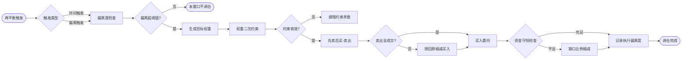

# S21-02｜再平衡流程图、数值走查与组合用例

- 文档编号：S21-02｜版本：v1.0｜日期：2026-11-13｜主责：角色3（A3），A5/A7 会签
- 工程依据：《工程正文_Doubao》S21 走查、迭代收敛、成本影响、执行偏离度；评审条件（A5：**组合模式熔断生效且熔断期间禁止调仓买入**；A7：**构造"卖出全部涨停"极端用例**）
- 图表规范：铁律八（LR、全实线、节点≤12字、形状合规、分支解释表）

---

## 1. 再平衡流程图（LR）

### 分支解释表
| 编号 | 分支ID | 分支含义 | 正常逻辑 | 异常分支 | 边界条件 | 失效后果 | 整改措施 |
|---|---|---|---|---|---|---|---|
| 1 | E1 | 触发类型判断 | 时间/偏离取先触发者 | 事件触发（池剔除） | 三类不可全开（过度交易） | 触发混乱过度调仓 | 默认只开阈值+最小间隔5日 |
| 2 | E2 | 偏离度检查 | 任一标的偏离>5个百分点 | 全部达标 | 偏离阈值默认5个点 | 调仓时机失准 | 阈值外置配置（表36） |
| 3 | E3 | 偏离未超阈 | 本窗口不调仓 | 长期偏离（阈值过严） | 偏离阈值风险列已登记 | 权重长期漂移 | 阈值按波动率差异标的校准 |
| 4 | E4 | 生成目标权重 | 按目标配置计算 | 目标权重缺失 | 组合配置区块（S20表34） | 权重无依据 | 报告模板组合配置区块强制 |
| 5 | E5 | 权重二次约束 | 单标的/行业/流动性三道过+归一迭代 | 迭代3次不收敛 | 迭代上限3次 | 权重超界或无处安放 | **报错"约束不可满足"+具体冲突项**，退回上可行解 |
| 6 | E6 | 先卖后买-卖出 | 卖出按超配降序，成交得现金 | 跌停卖不出 | 卖出全部涨停（A7用例） | 资金不足死锁 | 买入以实际回款动态调整，未成交自动取消 |
| 7 | E7 | 卖出未全成交 | 按实际回款等比例缩减买入 | 回款为零 | 不允许透支 | 买单被拒/透支 | 缩减算法+记录"卖出未成交调仓未完成" |
| 8 | E8 | 买入委托 | 买入按低配降序，同标的当日不既卖又买 | 买单被拒 | 资金守恒检查 | 调仓偏离目标 | 缺口比例缩减买单 |
| 9 | E9 | 资金守恒检查 | 卖出回款+可用现金≥买入所需 | 不足 | 按缺口比例缩减 | 现金不足买单被拒 | 缩减算法向下取整到百股 |
| 10 | E10 | 记录执行偏离度 | 实际权重vs目标权重绝对值之和 | 偏离>10% | 报告标注未按目标执行 | 报告显示按目标、实际偏离大 | 偏离度入报告+调仓日志 |

## 2. 数值走查（工程正文）

组合目标权重：甲30%、乙30%、丙20%、丁20%，总权益10万。再平衡日实际权重：甲40%、乙20%、丙20%、丁20%。
- **偏离度**：甲偏高10个百分点>5点阈值→触发再平衡；
- **目标金额**：甲3万、乙3万、丙2万、丁2万；**实际金额**：甲4万、乙2万、丙2万、丁2万；
- **执行顺序**：**先卖甲1万，成交后现金1万；再买乙1万**；
- **跌停降级**：**若甲当日跌停无法卖出，则买入按回笼资金零执行，乙保持2万不动，偏离保留到下次窗口，并记录"卖出未成交导致调仓未完成"**。

## 3. 迭代收敛实例

单标的上限30%、行业上限50%、只允许持有2只，目标权重各50%：
- **两道约束冲突**：按行业上限两只各50%合计100%正好，按单标的上限30%则合计60%，**剩余40%无处安放**；
- **迭代三次后仍不收敛**→判定约束矛盾→**退回上一可行解并报错"约束不可满足"**；**报错必须给出具体冲突项**（如"单标的上限30%与持有数2冲突"），否则使用者以为是算法缺陷。

## 4. 交易成本定量影响

月度调仓、每次双边成本千分之二、年化换手4.8倍 → **年成本约0.96%**。
**若策略年化超额只有2%，成本吃掉近一半**。
**推论**：**降低调仓频率往往比优化信号更有效**；阈值触发默认5个百分点而非1个的原因在此。

## 5. 执行偏离度记录

每次调仓记录"**执行偏离度**"=实际权重与目标权重绝对值之和；**偏离度超过10%时在报告中标注**。
**作用**：防止"报告显示按目标权重持有，实际持仓与目标差距很大"的错觉。

## 6. 组合用例（S25 回归落点）

- **TC-COMB-001 先卖后买+守恒检查**（A3 核心）：构造现金不足场景，断言先卖后买、守恒检查缩减买单、无透支；
- **TC-COMB-002 卖出全部涨停**（A7 条件项）：全部卖出标的涨停无法成交，断言买入按回款零执行、记录"调仓未完成"、偏离保留到下次窗口；
- **TC-COMB-003 熔断禁调仓买入**（A5 条件项）：组合模式触发熔断，断言熔断期间禁止调仓买入、已持仓不强制平仓（S07 语义延续）；
- **TC-COMB-004 权重二次约束收敛**：构造约束矛盾场景（上限30%+持有2只），断言迭代3次报错"约束不可满足"+具体冲突项+退回上可行解；
- **TC-COMB-005 执行偏离度记录**：构造缩减买入场景，断言执行偏离度入报告，>10%标注；
- **TC-COMB-006 资金重复占用防护**（S20 翻车点）：多标的同时调仓，断言两阶段决策（信号集落盘）+守恒检查，无重复占用。
